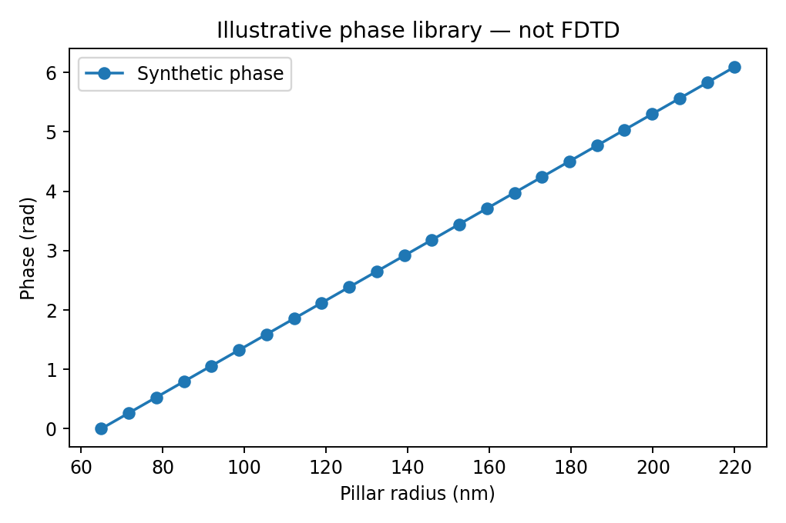
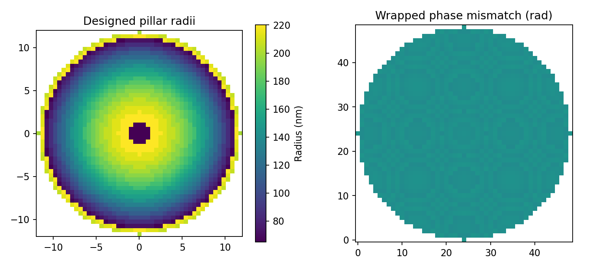
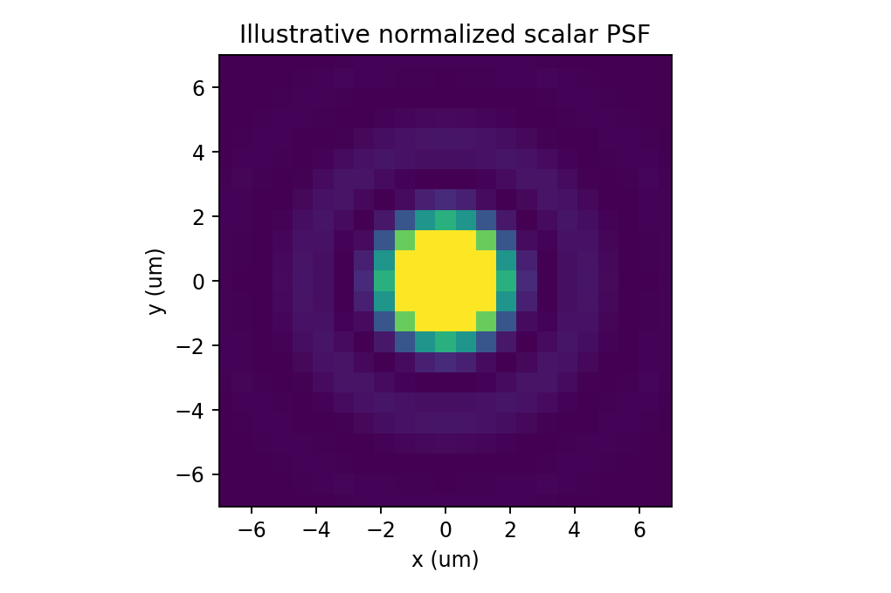

# Python Metalens Design — Synthetic Phase-Library Demonstrator

**Forouzan Habibighahfarokhi**

A small, self-contained computational optics project illustrating phase-library-based
metalens design with NumPy and a scalar Fourier focal-plane model.
**No Ansys Lumerical, Zemax OpticStudio, COMSOL, license server, original simulation
project, or external lookup table is required.**

## What the repository does

- Computes the ideal hyperbolic phase for a circular focusing aperture.
- Uses an **artificial/synthetic** phase-versus-radius library to select a radius
  at each lattice site by minimizing wrapped phase mismatch.
- Illustrates a selected-radius map, phase error, and normalized scalar focal-plane
  intensity, and compares an ideal pupil with the synthetic library pupil.
- Includes numerical checks for phase wrapping, radial symmetry, pupil masking,
  centered focusing, and approximate Airy FWHM.


## Example design (illustrative, not a physical BIG design)

| Parameter | Value |
|---|---:|
| Wavelength | 1.55 µm |
| Aperture radius | 12 µm |
| Nominal focal length | 40 µm |
| Lattice pitch | 0.50 µm |
| Library | 24 artificial phase/radius states |

## Example results

| Synthetic phase library | Selected radius map | Normalized scalar focal plane |
|---|---|---|
|  |  |  |

## Numerical scope and limitations

This is an **educational scalar-optics demonstrator**, not an electromagnetic
prediction of a fabricated metalens. The phase library and transmission values
are **synthetic**, not RCWA/FDTD results. No realistic meta-atom coupling, material
dispersion, fabrication tolerances, magneto-optic effect, high-NA vector field,
absolute focusing efficiency, physical RCP/LCP differentiation, or verified
Zernike aberrations are modeled. Peak-normalized intensity cannot establish
absolute efficiency or Strehl ratio.

The implementation analytically removes the ideal focusing phase and Fourier
transforms the residual-phase pupil as a simple scalar focal-plane approximation;
it is not an exact high-NA propagation solver.

## Project layout

```text
metalens-portfolio-public/
├── src/metalens_portfolio/core.py   # Numerical utilities
├── examples/run_demo.py            # Generates synthetic examples
├── tests/test_core.py              # Unit tests
├── figures/                        # Generated illustrations and CSV
├── requirements.txt
├── .gitignore
├── PUBLISHING.md                    # Safe VS Code publishing instructions
└── README.md
```

